# はじめに

2026/10/28 に発表された「Amazon EKS Auto Mode が Kubernetes Gateway API をサポート」について、調べたことをまとめます。

https://aws.amazon.com/about-aws/whats-new/2026/10/amazon-eks-auto-mode-kubernetes-gateway-api/

:::message
- 🤖 **AIの解説** は Claude が書いた解説です。内容がまちがっている可能性があります
- ✍️ **自分の調査・勉強結果** は、自分で実際に確認・調査した内容です
:::

# 🤖 AIの解説

| 項目 | 内容 |
|---|---|
| **要約** | EKS Auto Mode が Kubernetes の Gateway API に対応し、クラスターで有効にすれば、Gateway や HTTPRoute などを書くだけで AWS のロードバランサー（ALB・NLB）が自動で用意されるようになった |
| **料金** | 機能自体は EKS Auto Mode に含まれる。作られたロードバランサーの通常の料金はかかる |
| **対象** | EKS Auto Mode が使えるすべてのリージョン |

:::details そもそも EKS Auto Mode と Gateway API とは？
| 名前 | ひとことで |
|---|---|
| Amazon EKS | Kubernetes（コンテナをまとめて動かす仕組み）を AWS で動かすサービス |
| EKS Auto Mode | サーバーやネットワークなど、クラスターの周りの準備まで AWS が自動でやってくれる EKS の使い方 |
| Ingress | これまでの、外からのアクセスをアプリに振り分けるための Kubernetes の設定 |
| Gateway API | Ingress の次の世代の、アクセスの振り分けの標準の書き方。Gateway（入口）と HTTPRoute（振り分けのルール）などに分かれている |
:::

**今回なにが変わった？**

|                            | これまで                                                | これから                                                                                    |
| -------------------------- | --------------------------------------------------- | --------------------------------------------------------------------------------------- |
| Gateway API を使うには          | コントローラー（AWS Load Balancer Controller など）を自分で入れて設定する | クラスターの設定で有効にするだけ。コントローラーは入れなくてよい                                                        |
| Gateway API の定義（CRD[^crd]） | 自分で入れて、更新する                                         | AWS に管理を任せる（Managed）か、自分で管理する（Unmanaged）かを選べる                                           |
| できること                      | ―                                                   | HTTP・gRPC の振り分け（ALB）と TCP・UDP の振り分け（NLB）、名前空間をまたぐ振り分け、重み付けでの分割、ヘッダーでの振り分け、ACM の証明書の自動検出 |
| 既存の Ingress                | ―                                                   | そのまま一緒に使える                                                                              |

**どんなときにうれしい？**
新しいバージョンを 1 割のアクセスだけで試す、チームごとに名前空間を分けて入口は共有する、といった振り分けを、Kubernetes の標準の書き方でしたいとき。コントローラーの運用やアップデートの手間もなくなります。

:::message alert
- 使う前に、クラスターの設定で Gateway API を有効にする必要があります（Managed か Unmanaged を選ぶ）。すでに CRD が入っているクラスターで Managed を選ぶには、CRD が v1 になっている必要があります
- ロードバランサーを置くサブネットを見分けるため、サブネットにタグが必要です（eksctl で作ったクラスターなら付いています）
- Gateway API の項目のすべてが、ALB・NLB の機能に対応しているわけではありません
:::

:::message
**確認ポイント**
EKS コンソールのクラスターの設定で、Gateway API の有効化と Managed / Unmanaged の選択。GatewayClass の `controllerName` には、ALB なら `eks.amazonaws.com/gateway-alb`、NLB なら `eks.amazonaws.com/gateway-nlb` を指定する
キーワード: EKS Auto Mode Gateway API, GatewayClass, HTTPRoute, gatewayApi.crds.managed
:::

[^crd]: Custom Resource Definition。Gateway や HTTPRoute といった、Kubernetes の設定の種類そのものの定義


# ✍️ 自分の調査・勉強結果

EKS Auto ModeのクラスターでGateway APIを実際に動かして、ALBが自動でできるところと、重み付け・ヘッダーでの振り分けを試してみます。
Kubernetesはさわるの初めて。（ECSは触れたことある）
AWSの資格勉強で座学でしか触れたことがないので、手順や用語はClaudeに聞きながら進めました。
正直、理解しきれていないところが多々ありますが、まずは手を動かす！を信条にやっていきます！

## 準備：VPCを作る
EKSのノードはプライベートサブネットに置くので、外に出るためのNATゲートウェイも入れた構成にします。

| 項目         | 設定                      |
| ---------- | ----------------------- |
| CIDR       | `10.1.0.0/16`           |
| AZ         | 2つ（1a・1c）               |
| サブネット      | パブリック2つ・プライベート2つ        |
| NATゲートウェイ  | Zonal・1個のAZ内（検証なので1個だけ） |
| VPCエンドポイント | なし                      |

久しぶりに作成画面を見るとNATゲートウェイの欄が「更新しました」になっていて、「なし」「リージョナル - 新規」「Zonal」の3択になっていました。
リージョナルは、1つのNATゲートウェイが使っているAZに自動で広がってくれる新しいタイプ。

研修期間中はよく見てたけど、いざ働き出すと実務に近い勉強をしてたので、離れてる間にどんどん進化してるな～と改めて思いますね。

### 失敗1：VPCの作成が「ロールバックに失敗しました」
VPCコンソールの「VPCなど」で一気に作ろうとしたら、NATゲートウェイのところで止まりました。
VPC・サブネット・インターネットゲートウェイ・パブリック用のルートテーブル・Elastic IPまではできていて、NATゲートウェイが「見つからない」と言われ、ロールバックも同じエラーで失敗。

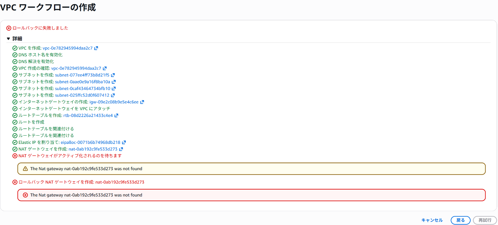

NATゲートウェイの一覧を見ると、状態は`Deleted`。
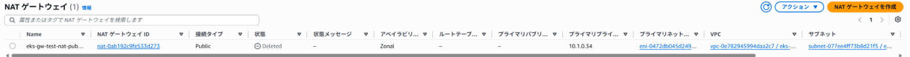

誰が消したのか、CloudTrailのイベント履歴で調べてみました。

| 時刻 | イベント | 誰が |
|---|---|---|
| 22:12:50 | `CreateNatGateway` | 自分（コンソールから） |
| 22:12:52 | `DeleteNatGateway` | 自分（コンソールから） |

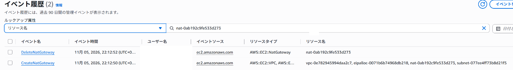

作った2秒後に、自分のコンソールのセッションから消されていました。
ん～～～～記憶ないけどなんか当たった？なんだろう？
`DeleteNatGateway`の記録を見ると、ブラウザ（Chrome）から、コンソールのセッション（`sessionCredentialFromConsole: true`）で実行されています。
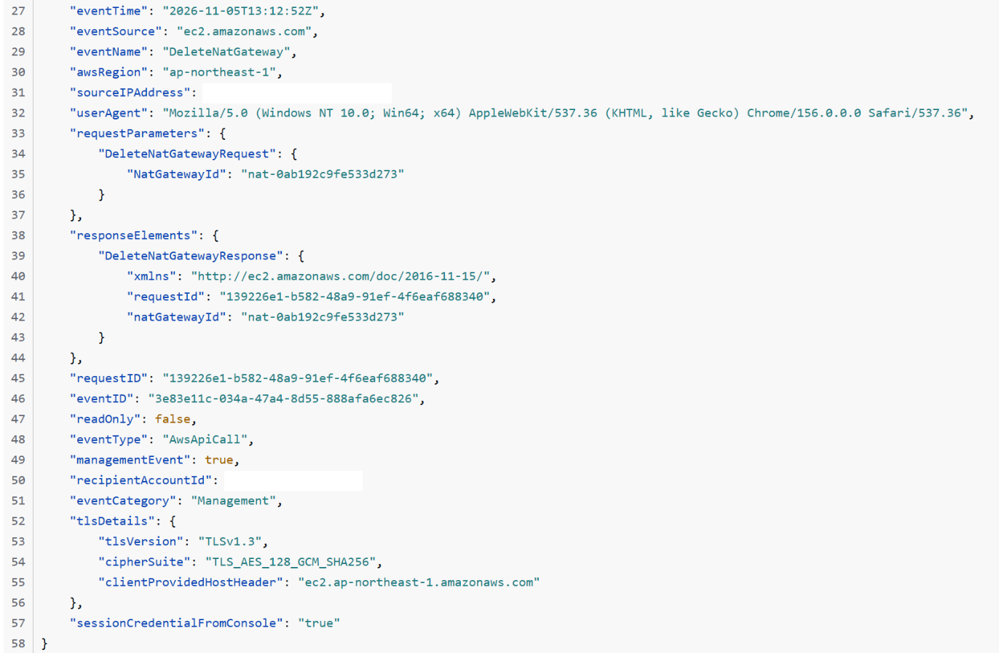
原因は結局不明。

### 対処：NATゲートウェイを手で足す
作れなかったのはNATゲートウェイだけなので、自分で足しました。
久しぶりすぎて最初プライベートサブネットにNATゲートウェイ作成してて自分で驚愕した笑
ルート入れるときに「・・・あれ？あ、パブリックサブネットに作るんだった照」ってなりました。
#### NATゲートウェイを作る
| 項目 | 設定 |
|---|---|
| 可用性モード | Zonal |
| サブネット | パブリックサブネット（public1） |
| 接続タイプ | パブリック |
| Elastic IP | 失敗したときに残っていたものを使う |

Elastic IPって、付けなくてもよかった気がする…と思って、付けずに作ろうとしたら作れなかった。
そういえばそれはEC2の話で、またもや混同していました照

|                       | Elastic IP                                  |
| --------------------- | ------------------------------------------- |
| EC2                   | なくてもいい。<br>自動で割り当てられるパブリックIPでも外に出られる。       |
| NATゲートウェイ<br>（パブリック）  | **必須**。<br>外への通信の送信元になる、固定のIPが必要。           |
| NATゲートウェイ<br>（プライベート） | 不要。<br>インターネットには出ずに、別のVPCなどにIPを変換してつなぐためのもの |

ちなみに、2024年2月からパブリックIPv4は使っていても有料なので、EC2で自動のパブリックIPにしても、お金がかかるのは同じ。

`Available`になりました。
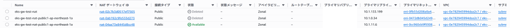

#### プライベート用のルートテーブルを作る
新しくルートテーブルを作って、`0.0.0.0/0`をNATゲートウェイに向けました。
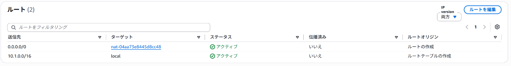

プライベートサブネット2つを関連付け。
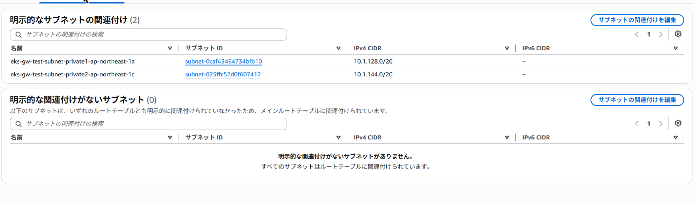
### サブネットにタグを付ける
さて、ここからはほぼClaudeに頼り切り、なんとか時間をかけすぎずかといってある程度身に着けたい。
Auto Modeでロードバランサーを使うときは、サブネットにタグが必須というルールがあるそうです。
指定のタグをつけるってのは、他のサービスでもちょくちょくありますね。

ALBを置くサブネットを選ぶときの目印で、以下のタグが付いたサブネットが使われる。
- インターネット向けならパブリック：`kubernetes.io/role/elb`
- 内部向けならプライベート：`kubernetes.io/role/internal-elb`
https://docs.aws.amazon.com/ja_jp/eks/latest/userguide/tag-subnets-auto.html

「VPCなど」で作ったVPCには付かないので、自分でタグを付与。
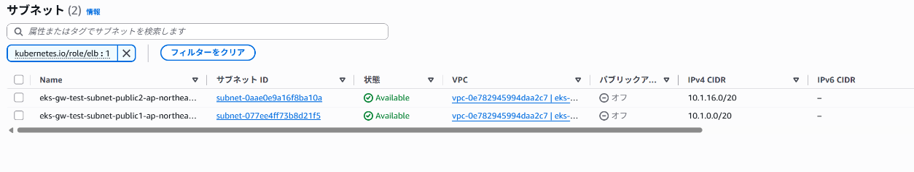
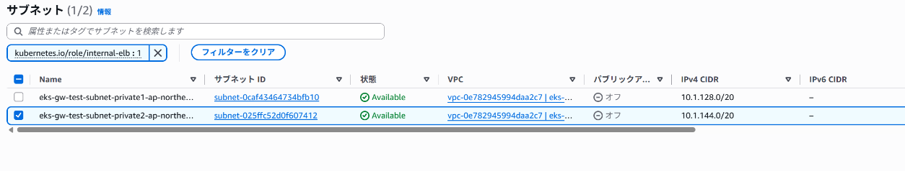
## EKSクラスターを作る
クイック設定があったのでこれを見て作ります！
[AWS マネジメントコンソール を使用して EKS Auto Mode クラスターを作成する - Amazon EKS](https://docs.aws.amazon.com/ja_jp/eks/latest/userguide/automode-get-started-console.html)
作ったVPCのプライベートサブネット2つを選んで作成。
クラスター名には、最初から`thoughtful-country-potato`（思慮深い田舎のじゃがいも？）が入ってたのでこのまま使います。
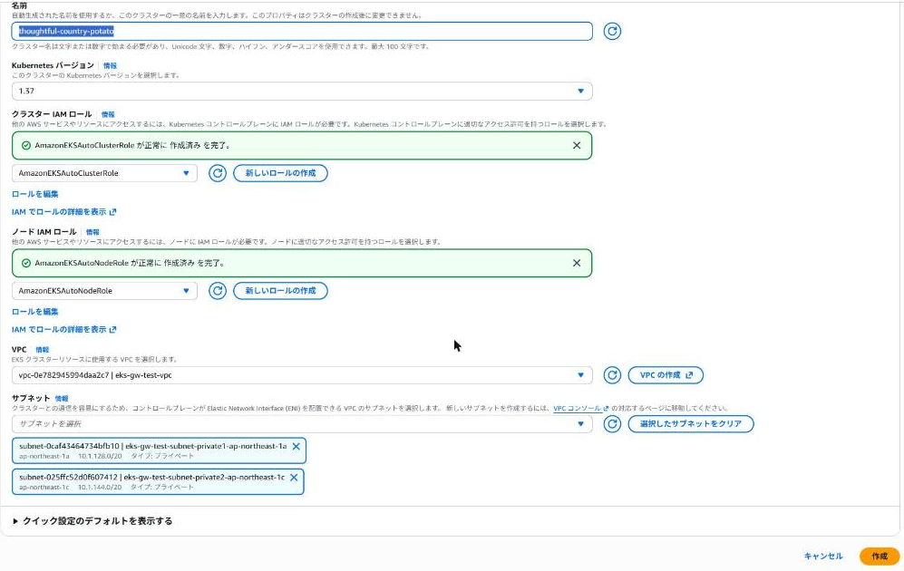

10分ほどで`アクティブ`になりました。
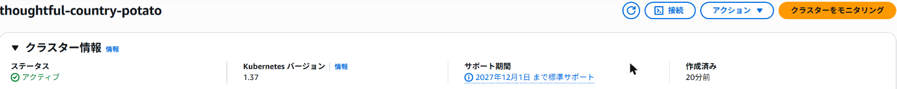


## EKSクラスターがアクティブになるまでの間に軽く学習
クラスターがアクティブになるには上記の通り10分程度必要なので、このタイミングで以下を読みました。
Claudeに要約してもらってさらっとだけ。
（10分は余裕で超えた。）
[Configure the Kubernetes Gateway API in EKS Auto Mode - Amazon EKS](https://docs.aws.amazon.com/eks/latest/userguide/auto-configure-gateway-api.html)
知らない単語がいっぱい・・・要は「EKS Auto Modeなら、Gateway APIのYAMLを書くだけでALB/NLBが自動で作られる。」ということらしいけどとにかく知らない単語や概念が多い。
AWSの資格勉強で見たこと自体はあっても、それ以降勉強してないのもありちゃんと知らないなぁって痛感ですね。
### Gateway APIってなに？
名前が似てるからAPI Gatewayにすごい引っ張られるけど、Gateway APIは全くの別物でした。
[Introduction | Gateway API](https://gateway-api.sigs.k8s.io/docs/introduction/)
AWSというよりKubernetesのリソースの仕様で、YAMLで書くそうです。

「クラスタの外から来たリクエストを、ルールに従ってどのServiceに届けるかを決められる」って感じみたいです。
振り分けなどのルール設定はGateway APIのYAML（HTTPRoute）に書くってことか、たしかにそれ考えるとALBが自動作成できるの便利そう。

アップデート前は手動で作ってたの？と聞くと「ALBを作ってくれるコントローラーを入れてた」と言われました。
まだ知らん事出てきた。

### コントローラーってなに？
コントローラーは、「「YAMLに書いた状態」と「実際の状態」を見比べて、ずれていたら実際のほうを直し続けるプログラム」だそうです。
なるほど、じゃあGateway APIのYAMLを変えると、実環境の設定はコントローラーが合わせてくれるってことか。
https://kubernetes.io/ja/docs/concepts/architecture/controller/

### CRDってなに？
>[CustomResourceDefinition](https://kubernetes.io/docs/tasks/extend-kubernetes/custom-resources/custom-resource-definitions/)（CRD）というAPIリソースで、カスタムリソースを定義する。
CRDオブジェクトを定義することで、指定した名前、スキーマで新しいカスタムリソースが作成される。
参照：[カスタムリソース | Kubernetes](https://kubernetes.io/ja/docs/concepts/extend-kubernetes/api-extension/custom-resources/)

すごいざっくり…Kubernetesに新しい種類のリソースを教えるための定義みたい。
カスタムリソースって書いてる通りで、Gateway APIのGatewayやHTTPRouteは通常使えないけど、CRDを入れれば使えるようになるそうな。
### kubectlとは？
キューブコントロールやキューブシーティーエルと読むらしい。
Kubernetesのクラスターに命令を出すためのコマンド。
AWS CLIのk8s版って感じかな。
https://kubernetes.io/ja/docs/reference/kubectl/
## Gateway APIを有効にする
EKSクラスターがアクティブになったので続ける。
クラスターの「設定」タブ→「ネットワーキング」を見ると、Gateway API CRD管理は`アンマネージド`になっていました。
クイック設定で作ると、最初はこちらみたいです。
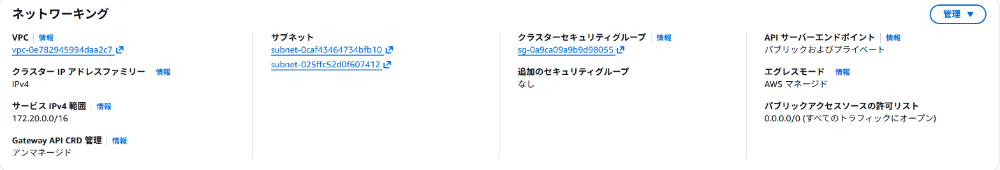

「管理」から`マネージド`に変更。
これでCRDの入れ替えまでAWSに任せられるらしいです。
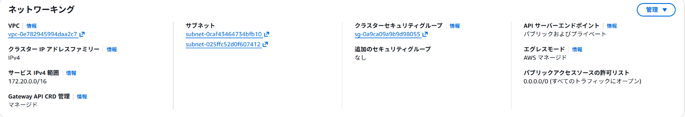

「Gateway API CRD管理」をマネージドにしたので、CRDはAWSが入れてくれたはず。
入ったCRDの一覧はドキュメントで見つけられなかったけど、kubectlで確認。

CloudShellから見ると、Gateway APIのCRDが入っていました。
`gateway.networking.k8s.io`がGateway APIの標準のもので、`gateway.k8s.aws`はAWS独自の設定用のものみたいです。
https://gateway-api.sigs.k8s.io/reference/api-spec/
https://docs.aws.amazon.com/eks/latest/userguide/auto-configure-gateway-api.html
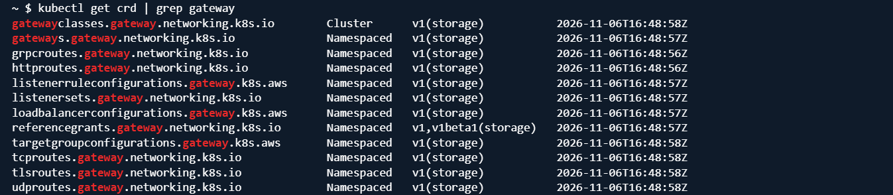

## アプリを用意する
`v1`・`v2`と文字を返すだけのアプリ（`hashicorp/http-echo`）を2つ、DeploymentとServiceで動かしました。Claudeいわく、DeploymentはECSの「サービス」に近くて、k8sのServiceはアプリへの入口だそうです。

Podを動かす前はノードが1台でしたが、Podを動かしたら、Auto Modeが勝手にノードを1台足していました。
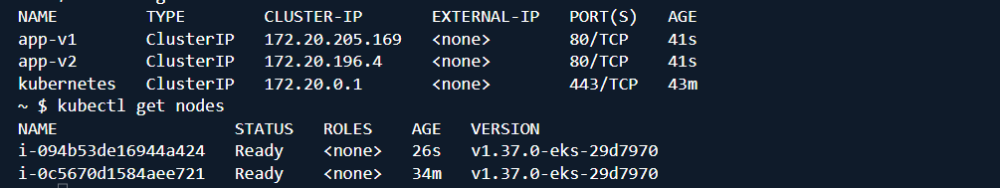

## Gatewayを作る→ALBができる
GatewayClass（ALBを使う、という宣言）・LoadBalancerConfiguration（インターネット向けにする設定）・Gateway（入口）の3つを作ります。
YAMLはClaudeに書いてもらったので、正直1行ずつはまだ理解できていません。
以降についてもYAMLは全てClaudeが作成したものになります。

```yaml:gateway.yaml
apiVersion: gateway.networking.k8s.io/v1
kind: GatewayClass
metadata:
  name: eks-auto-alb
spec:
  controllerName: eks.amazonaws.com/gateway-alb
---
apiVersion: gateway.k8s.aws/v1
kind: LoadBalancerConfiguration
metadata:
  name: public-lb
  namespace: default
spec:
  scheme: internet-facing
---
apiVersion: gateway.networking.k8s.io/v1
kind: Gateway
metadata:
  name: my-gateway
  namespace: default
spec:
  gatewayClassName: eks-auto-alb
  infrastructure:
    parametersRef:
      group: gateway.k8s.aws
      kind: LoadBalancerConfiguration
      name: public-lb
  listeners:
    - name: http
      protocol: HTTP
      port: 80
```

数分で`PROGRAMMED`が`True`になり、ALBのアドレスが入りました。


EC2のロードバランサーの画面にも、`k8s-default-mygatewa-…`というALBができていました。
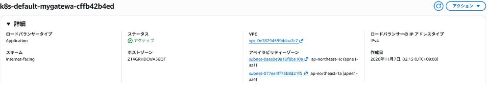

ただ、この時点ではリスナーが0個。
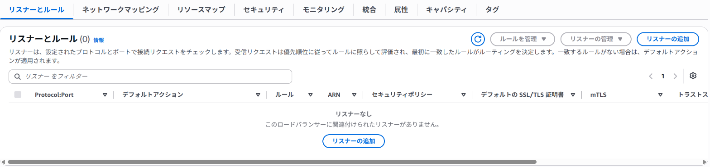

## HTTPRouteを作る→リスナーができる
全部`app-v1`に送るHTTPRouteを作りました。

```yaml:route.yaml
apiVersion: gateway.networking.k8s.io/v1
kind: HTTPRoute
metadata:
  name: my-route
spec:
  parentRefs:
    - name: my-gateway
      sectionName: http
  rules:
    - backendRefs:
        - name: app-v1
          port: 80
```

作った直後のcurlは`Failed to connect`でしたが、少しして`v1`が返ってきました。
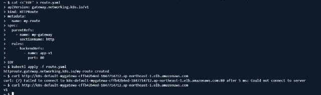

ALBには、HTTPRouteを作ったタイミングでリスナー（HTTP:80）ができていました。
Claudeに聞くと、直後のエラーはまだリスナーがなかったからでは、とのこと。
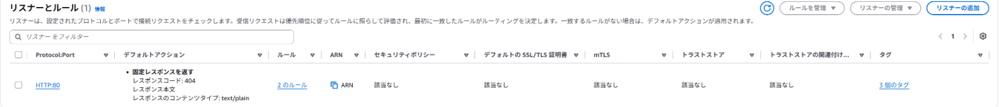

Gatewayで「ALBという入れ物」、HTTPRouteで「中身のリスナーとルール」ができる、という分担みたいです。

## 重み付けで振り分ける
HTTPRouteの送り先（v1とv2）に重みを付けて、v1に90、v2に10を送るようにしました。
YAMLでは送り先のServiceを並べる欄が`backendRefs`で、それぞれ`weight: 90`と`weight: 10`を書き足せばOKみたいです。

```yaml
  rules:
    - backendRefs:
        - name: app-v1
          port: 80
          weight: 90
        - name: app-v2
          port: 80
          weight: 10
```

100回curlすると、v1が93回、v2が7回。
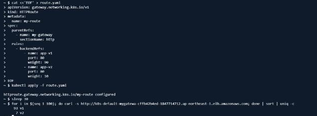

ALBのルールを見ると、Serviceごとにターゲットグループができていて、重みがそのまま入っていました。
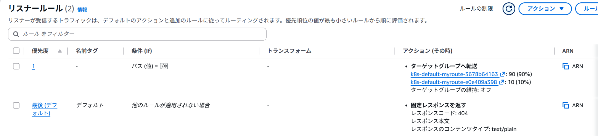

## ヘッダーで振り分ける
ヘッダーでの振り分けも、今回のアップデートでできるようになったことの1つなので試してみました。
決まったヘッダーを付けた人だけを新しいバージョンに流す、みたいな使い方ができるそうです。

`x-version: v2`が付いたアクセスは必ずv2へ、それ以外は90:10のままにしました。

```yaml
  rules:
    - matches:
        - headers:
            - name: x-version
              value: v2
      backendRefs:
        - name: app-v2
          port: 80
    - backendRefs:
        - name: app-v1
          port: 80
          weight: 90
        - name: app-v2
          port: 80
          weight: 10
```

ヘッダーありは20回ともv2、なしは93:7でした。
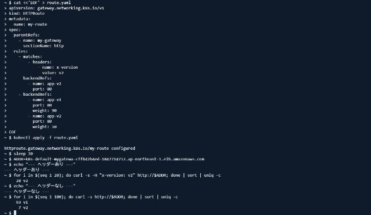

ALBのルールが3つに増えていて、YAMLに書いた順番がそのまま優先度の順番になっていました。
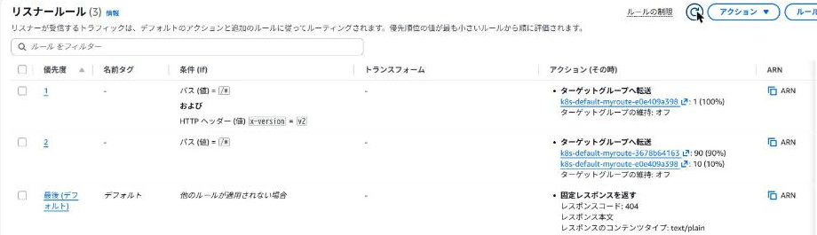

## ALBを手で書き換えたらどうなる？
ALBはKubernetesが作ったものですが、コンソールから手で書き換えたら戻されるのか、試してみました。
ルール2の重みを、コンソールで50:50に変更。
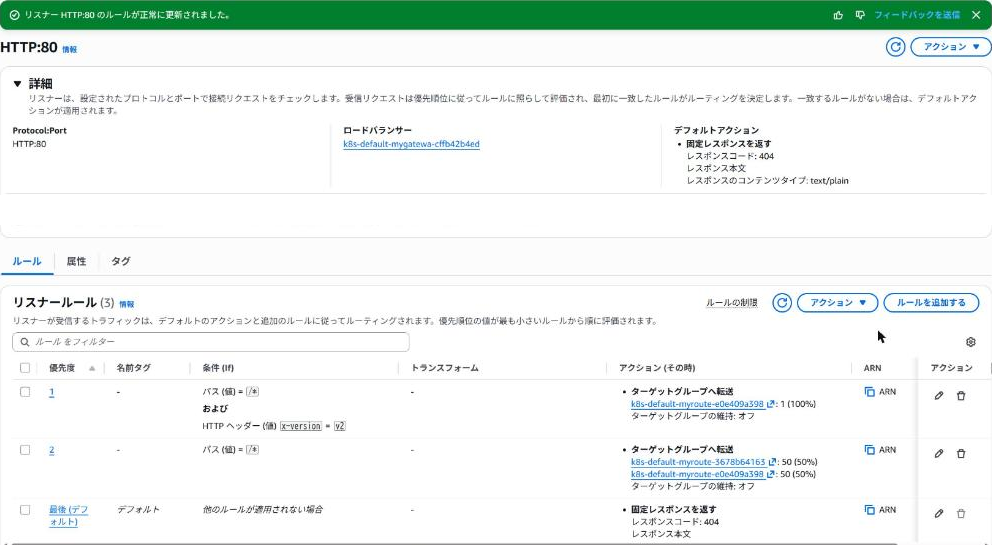

10分ほど待っても、50:50のままでした。
勝手に直しには来ないみたいです。

そこで、HTTPRouteのほうを80:20にしてapplyすると、手で入れた50:50は消えて、80:20になりました。
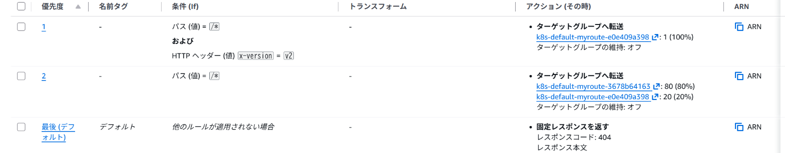

ALBを手で直しても、次に誰かがapplyしたら消えます。設定を変えるなら、YAMLのほうを変えるしかないですね。
学習のところで調べた「YAMLに書いた状態に、実際の状態を合わせる」コントローラーの動きは、これのことか。

## コントローラーは入っていない？
クラスターで動いているPodを見ると、自分のアプリとmetrics-serverだけ。
これまでは自分で入れる必要があったAWS Load Balancer ControllerのPodはありませんでした。
Claudeいわく、ALBを作っているコントローラーはAWSの側で動いているらしいです。
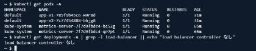

## 片付け
Kubernetesのリソースを消すと、ALBもターゲットグループも一緒に消えました。
そのあと、クラスター・NATゲートウェイ・Elastic IP・VPCを消しました。
よく知らないサービスだからコツコツやりたかったけど、コストがバカにならないので急ぎで終わらせました。
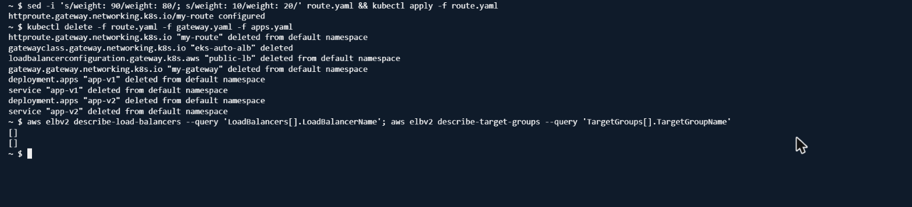

## よく分かっていないこと

- k8sの基本がまだふわっとしている
- Claudeに書いてもらったYAMLの中身（どの行が何をしているか）
- ALBを手で書き換えても戻らなかったのが、たまたまなのか、そういう仕様なのか
- 手で書き換えたALBの設定が、どのタイミングで上書きされるのか

## まとめ

- EKS Auto ModeでGateway APIを使うには、クラスターの設定でGateway API CRD管理を選ぶだけ<br>コントローラーを入れなくても、YAMLを書けばALBができた
- Gatewayを作るとALBが、HTTPRouteを作るとリスナーとルールができる。重み付けやヘッダーの条件は、ALBのルールにそのまま変換される
- ALBを手で書き換えても、すぐには戻されない<br>ただ、Kubernetes側を変えると、YAMLの内容で上書きされる
- Podを動かすとノードが自動で増えたりして、クラスターの周りはかなりAWS任せなんだなと感じた
- NLB（TCP・UDP）やACMの証明書の自動検出、名前空間をまたぐ振り分けは試せていません

# 参考

- [週刊AWS – 2026/10/26週](https://aws.amazon.com/jp/blogs/news/aws-weekly-20261026/)
- [Amazon EKS Auto Mode が Kubernetes Gateway API をサポート](https://aws.amazon.com/about-aws/whats-new/2026/10/amazon-eks-auto-mode-kubernetes-gateway-api/)
